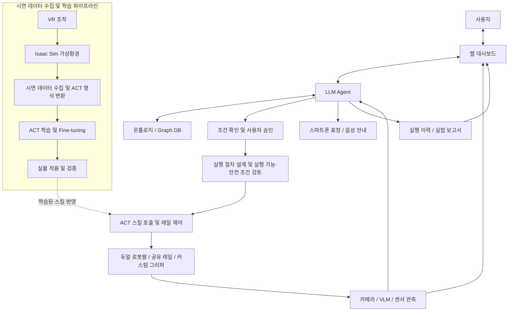
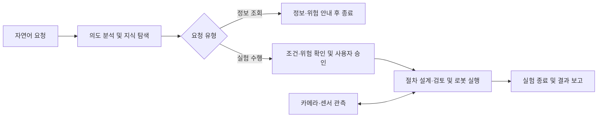
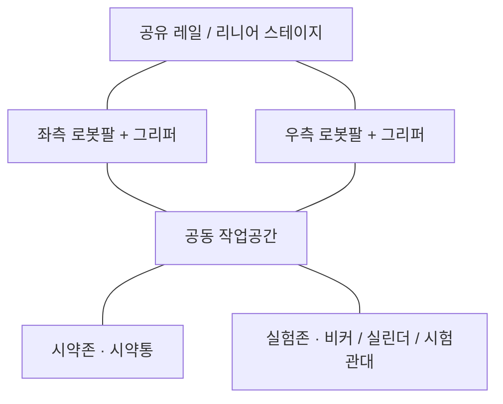
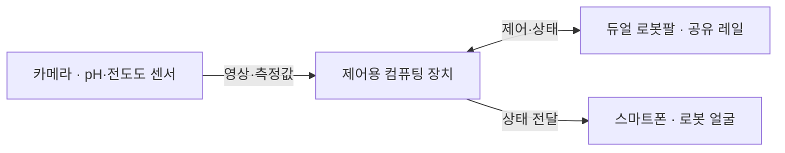
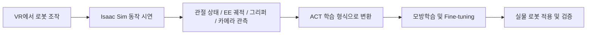

  
  <h1>ARMChemist</h1>
  
<strong>Physical AI for Autonomous Chemistry</strong>

  
자연어 요청부터 지식 탐색, 실험 계획, 로봇 조작과 기록까지 연결하는 화학실험 보조 시스템

  

    <a href="#1-프로젝트-개요">프로젝트 개요</a> ·
    <a href="#2-팀원-소개">팀원 소개</a> ·
    <a href="#3-시스템-아키텍처">시스템 아키텍처</a> ·
    <a href="#4-시연">시연</a> ·
    <a href="#5-핵심-소스코드">핵심 소스코드</a>
  

  

    
    
    
  

---

## 1. 프로젝트 개요

> **자연어 요청 → 지식 탐색 → 실험 계획 → 듀얼 로봇팔 수행 → 기록**까지 하나의 흐름으로 연결하는 Physical AI 화학실험 보조 시스템

### 개발 배경

- **위험 노출:** 시약통 잡기, 뚜껑 열기, 용액 붓기 등 반복 조작에서 유해 물질에 직접 노출됩니다.
- **사고 부담:** 기구 파손, 용액 유출, 장비 충돌에 계속 주의해야 합니다.
- **수기 기록:** 실험 과정과 센서값을 손으로 기록하는 부담이 큽니다.

→ 개별 장비 자동화를 넘어, 연구자가 **목표 설정과 판단**에 집중하도록 전 과정을 연결합니다.

### 핵심 특징

- **자연어 상호작용:** 정보 조회와 실험 수행을 구분하고, 대화로 조건을 구체화
- **지식 기반 계획:** 온톨로지·Graph DB로 실험 조건과 위험 정보 검토
- **LLM + ACT 역할 분담:** LLM Agent는 순서·실행 관리, ACT 정책은 학습된 조작 수행
- **양팔 협업 + 공유 레일:** 주작업/보조작업 분담, 접근 범위 확장
- **관측 기반 실행:** 액션 전후 관측을 확인해 다음 작업 진행 여부 판단
- **가상환경 데이터 수집:** Isaac Sim + VR로 사전 검증 및 시연 데이터 수집

### 주요 기능

| 기능 | 설명 |
|---|---|
| 실험실 정보 조회 | 시약·기구, 시약 특성과 위험성, 실험 조건 질의응답 |
| 대화형 조건 설정 | 목표·시약·용량 확인, 누락 정보 보완 |
| 승인과 실행 계획 | 조건·위험 안내 → 사용자 승인 → 스킬 호출 순서 설계 |
| 듀얼 로봇팔 조작 | 파지·이동·유지·뚜껑 조작·붓기·센서 투입 등 스킬 조합 |
| 관측 및 관제 | 카메라·센서·로봇 상태·진행 상황을 웹에서 확인 |
| 상태 전달 | 스마트폰 표정과 음성으로 상태·주의 상황 전달 |
| 기록 및 보고서 | 실행 이력·센서 관측 정리, PDF/CSV 제공 |

### 기대효과 및 활용 분야

| 기대효과 | 활용 분야 |
|---|---|
| 반복 조작·수기 기록 부담 완화 | 대학·교육기관의 로봇/화학실험 자동화 교육 |
| 유해 물질·위험 환경 직접 노출 감소 | 연구실 반복 조작, pH·전도도 측정 보조 |
| 실행 이력·관측 데이터 기반 추적·비교 | 웹 기반 원격 관제, 스마트 실험실 |
| 양팔 협업·스킬 조합으로 보조 작업 확장 | 양팔 조작·모방학습 시연 데이터 수집 플랫폼 |
| 가상환경 시연으로 기구 파손·충돌 부담 완화 | |

---

## 2. 팀원 소개

|  |  |  |  |  |
|:---:|:---:|:---:|:---:|:---:|
| **멘티 1** | **멘티 2** | **멘티 3** | **멘티 4** | **멘티 5** |
| 팀장 프론트엔드 | 하드웨어·로봇 구동 백엔드 | 프론트엔드 데이터 수집 | 온톨로지 구축 화학 도메인 지식 | 백엔드 |

---

## 3. 시스템 아키텍처

### 3-1. 전체 시스템 구성도

> 실험 서비스와 별도로, 디지털 트윈·VR 파이프라인이 로봇 스킬의 데이터 수집과 사전 검증을 담당합니다.

**사용자 요청 처리 흐름**

> 조건은 대화로 보완 → 승인 후 절차 설계 및 실행·안전 조건 검토 → 실행 중 동작 전후 관측으로 진행 여부와 이상 대응 판단

### 3-2. AI Agent 및 온톨로지

| 계층 | 역할 |
|---|---|
| **LLM Agent** | 요청 의도 구분 · 지식 탐색 · 누락 조건 확인 · 승인 후 작업 단위 분해 · ACT 스킬/양팔/레일 순서 결정 · 관측 확인 및 오류 대응 |
| **온톨로지 / Graph DB** | 시약·기구·조건·위험 정보의 관계 탐색 → 조건 검토, 지시약 선택, 위험 안내, 작업 계획에 활용 |

- 정보 조회는 답변으로 종료, 실험 수행은 **조건 확인 → 사용자 승인 → 실행** 순으로 진행합니다.
- 로봇 조작은 제한된 실행 도구와 학습된 스킬 호출로만 연결됩니다.

### 3-3. 하드웨어 구성 및 ACT 기반 로봇 실행

#### 하드웨어 구성도

**작업대 구성**

**제어 및 관측 연결**

> 두 로봇팔이 공유 레일로 시약존·실험존에 접근해 공동 작업공간에서 협업합니다. 관측값은 제어용 컴퓨팅 장치로 전달되고, 스마트폰은 상태를 표정으로 표시합니다.

#### 구성 요소별 역할

| 구성 | 역할 |
|---|---|
| 듀얼 로봇팔 | 물체 파지·유지·이동, 뚜껑 조작, 붓기 등 수행 |
| 공유 레일 | 시약존과 실험존에 접근할 수 있도록 작업 범위 확장 |
| 커스텀 그리퍼 | 실험기구의 형태와 작업에 맞춘 파지 지원 |
| 카메라·센서 | 작업공간과 실험 상태 관측 |
| 제어용 컴퓨팅 장치 | Agent·정책 실행 및 장비 통신·제어 |
| 스마트폰 | 표정을 통한 로봇 상태 전달과 사용자 상호작용 |

#### ACT 실행과 양팔 협업

- **ACT (Action Chunking with Transformers):** 사람 시연 데이터로 학습한 모방학습 정책. 카메라 관측과 관절 상태를 입력받아 행동 시퀀스를 생성합니다.
- **역할 분담:** LLM Agent는 스킬·순서·양팔/레일 계획을, ACT는 선택된 스킬의 동작을 담당합니다.
- **양팔 협업 예:** 한쪽 팔이 시약통을 유지하고 다른 팔이 뚜껑을 조작합니다. 센서 투입, 용액 붓기, 시험관대 이동, 실린더 배치도 같은 방식의 스킬 조합입니다.

### 3-4. 센서 및 실시간 관제

- **관측:** 카메라·VLM은 시각 상태를, pH·전도도 센서는 수치 상태를 확인하고 기구 식별·위치 정보와 함께 활용합니다.
- **실행 관리:** 관측값에 타임스탬프를 부여하고, 각 액션 직전 최신 관측을 재확인하며 동작 후 결과로 진행 여부를 판단합니다.
- **웹 대시보드:** 대화, 조건 확인·승인, 카메라·센서, 로봇 상태, 진행 상황, 결과 이력을 한 화면에 연결합니다.
- **보고서:** 종료 후 실행 기록과 관측 데이터를 정리합니다. 이상 징후 알림은 사전 위험 검토와 함께 사용자의 판단을 돕습니다.

### 3-5. Isaac Sim + VR 데이터 수집

- Isaac Sim 디지털 트윈은 실제 로봇의 URDF·운동학 특성, 듀얼 로봇팔·공유 레일, 작업공간과 기구 배치를 반영합니다.
- 접근과 동작을 사전 검토하고, VR로 파지·이동·붓기 시연을 수집해 반복적인 실물 시연 부담을 줄입니다.
- 활용 범위는 로봇 조작과 작업공간 검토 중심이며, 학습된 정책은 실물 적용과 검증으로 연결합니다.

### 3-6. 스마트폰 로봇 인터페이스

- 스마트폰 화면이 로봇의 **얼굴** 역할을 하며, 눈과 표정으로 대기·요청 처리·실험 수행·완료·오류/위험 상태를 전달합니다.
- 주의가 필요한 상황에는 표정 변화와 음성 안내를 함께 사용합니다.
- 웹 대시보드가 상세 정보를 제공한다면, 스마트폰 얼굴은 **로봇 주변 사용자가 상태를 빠르게 파악**하도록 돕습니다.

---

## 4. 시연

### 발표 자료

[ARMChemist 발표 자료 (Canva)](https://canva.link/0p77va368apy4tb)

### 작품 소개 영상

### 웹 UI

| 화면 | 기능 | 설명 |
|---|---|---|
|  | **초기 화면** | 시약·기구·장비·위험 관계를 그래프로 탐색하고, 추천 질문이나 채팅으로 실험을 시작 |
|  | **실험 구성** | 대화로 시약·기구·장비 구성, 위험 등급, 재고를 확인하고 구성 확정 |
|  | **모니터링** | 진행 단계, pH·EC·TDS·온도 센서값, 카메라 영상, 장비 로그, 위험 정보를 실시간 확인하고 일시정지·비상정지 |
|  | **결과 보고서** | 실행 요약, 사용 재료·위험, 절차, 센서 변화(pH·전도도), 타임라인을 정리하고 센서 CSV·PDF로 저장 |

---

## 5. 핵심 소스코드

### 5-1. AI Agent — 자연어 요청을 실행 계획으로 변환

사용자의 요청과 그래프 정보를 바탕으로 등록된 ACT 모델의 순서를 구성합니다. 각 스킬의 선행 조건을 검사하고, 작업 위치가 바뀌면 레일 이동을 계획에 추가합니다. 예를 들어 시약병을 잡지 않은 상태에서 뚜껑을 여는 계획은 실행 전에 거부합니다.

**동작 흐름:** 자연어 요청 → ACT 모델 선택 → 선행 조건 검증·레일 이동 삽입 → 사용자 확정 및 실행 요청

| 주요 소스 | 역할 |
|---|---|
| [openai_client.py](src/backend/agent/armchemist/openai_client.py) · `OpenAIPlanner` | 대화와 그래프를 입력받아 등록된 ACT 목록 안에서 실행 순서 생성 |
| [registry.py](src/backend/agent/armchemist/registry.py) · `CAPABILITIES` | 9개 ACT의 작업 위치, 사용 팔, 선행 조건과 실행 후 상태 정의 |
| [planning.py](src/backend/agent/armchemist/planning.py) · `compile_plan()` | 동작 순서 검증 및 스테이션 간 레일 이동 단계 삽입 |
| [api.py](src/backend/agent/armchemist/api.py) | 채팅·구성 확정·실행 API, 계획 버전 확인 및 중복 실행 차단 |

### 5-2. ACT 실행부 — 로봇 조작과 완료 판정

선택된 ACT 모델을 로드해 설정된 평균 시간만큼 실행하고, 로봇팔의 정지를 확인한 뒤 카메라 영상으로 완료 여부를 판정합니다.

**동작 흐름:** 모델 로드 → ACT 실행 → 현재 자세 유지·정지 확인 → 최신 영상 판정 → 다음 스킬 진행 또는 재시도

| 주요 소스 | 역할 |
|---|---|
| [runtime.py](src/backend/agent/armchemist/runtime.py) · `Runner.run()` | ACT 순차 실행, 완료 판정·재시도, 중단 처리 및 실행 이력 기록 |
| [physical_node.py](src/backend/agent/armchemist/physical_node.py) · `AgentPhysicalAIServer` | ROBOTIS `PhysicalAIServer`를 확장해 모델 로드, 추론 시간 관리, 양팔·그리퍼 자세 유지 및 정지 확인 |
| [ros.py](src/backend/agent/armchemist/ros.py) | rosbridge 서비스 호출과 카메라 토픽 수신, 정지 이후 영상 확보 |
| [openai_client.py](src/backend/agent/armchemist/openai_client.py) · `DecisionsJudge` | 동작별 완료 조건과 카메라 영상으로 완료 여부 판정 |
| [main.yaml](src/backend/agent/config/main.yaml) | ACT별 체크포인트, FPS, 평균 실행 시간, 카메라·관절 설정 |

### 5-3. 로봇팔·공유 레일 연동

로봇팔이 정지한 상태에서 보정된 관절 범위를 확인한 뒤 레일 이동을 요청합니다. 명령 ID로 실행 결과를 추적하고, 목표 스테이션 도착을 확인한 후 다음 ACT를 시작합니다.

**동작 흐름:** 로봇팔 정지·이동 허용 범위 확인 → 레일 명령 발행 → 목표 스테이션 도착 확인 → 다음 ACT 실행

| 주요 소스 | 역할 |
|---|---|
| [rail.py](src/backend/agent/armchemist/rail.py) · `CentralRail` | 중앙 서버에 레일 이동·정지 요청, 명령 결과와 도착 상태 확인 |
| [state.py](src/pi_sensor/central/state.py) · `Store` | 로봇팔 확인의 유효시간·재사용 여부 검사, 중복 명령 및 결과 미확인 상태의 새 이동 차단 |
| [stations.py](src/pi_sensor/server/hardware/stations.py) · `Stations` | 작업 스테이션 좌표 관리 및 레일 보정 상태 검사 |

설치·장비 설정은 [Agent 실행 안내](src/backend/agent/README.md), 테스트 및 실장비 검증 현황은 [검증 기록](src/backend/agent/docs/verification.md)을 참고하세요.

---

**2026 한이음 드림업 공모전 | ARMChemist**

